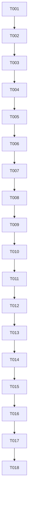

# Tasks: DSH rc.2 同步、缺陷修复与 Beta 交付

**Input**：本目录 spec.md、plan.md；根目录 `~/data/DSHM-deveco-workspace`。下列源码路径相对此根，证据路径亦相对此根。
**Tests**：需求明确要求全量回归及缺陷证据，保留现有检查并为新增判据提供变异体。
**执行纪律**：阶段 4 实施代理仅执行 T001–T015，不构建应用、不部署；阶段 5 唯一验证代理执行 T016–T018。不提交、不重置、不删用户数据/签名/历史交付，不改应用版本、权限、设备分档。

## Phase 1: Setup

- [X] T001 [P1] 保全已有改动，记录指定版本、目标树、实物差异、基线来源及保护边界；验收为可追溯且无凭据的现场清单，写入 dist/acceptance/20261112-rc2-sync-review.md
- [X] T002 [P1] 核对当前工具、官方文档通道、CI 与重跑脚本及已知 10 红，执行实施前基线；验收为每项命令与退出状态可查、受限单列，写入 dist/acceptance/20261112-rc2-sync-before.txt

## Phase 2: Foundational

- [X] T003 [P1] 修复协议提取器未定义版本来源及完整采集问题，加入必要负控制；验收为无环境版本变量仍能正确识别目标，冲突和缺目标不假绿，目标 tools/protocol-contract.mjs
- [X] T004 [P1] 用相同提取器重采 rc.1/rc.2 核心与扩展契约，审查重复、参数、流式及取消属性；验收为完整覆盖和可解释漂移，证据写入 dist/acceptance/20261112-rc2-contract-review.md

## Phase 3: User Story 1 — 完整 rc.2 核心（P1）

**独立验收**：配方、实际包版本、兼容表、插件与容器一致；数据保全与回滚检查通过，不冒称已真机恢复。

- [X] T005 [US1] [P1] 审核并迁移 rc.2 核心补丁，重点 terminal-panel、PTC、fs-local、搜索降级及 scope walk；验收为上游原生行为与本地补丁责任清晰、失效锚点不静默略过，目标 tools/pack-core.mjs
- [X] T006 [US1] [P1] 基于完整契约更新兼容定义、版本矩阵及来源元数据，验证漂移负控制；验收为生成源与目标同版且必要扩展未丢失，主要目标 dshcompat/src/main/ets/Endpoints.ets
- [X] T007 [US1] [P1] 对齐自带插件、profile 与宿主 rc.2 兼容约束，核查安装/升级数据保全和回滚路径；验收为相关行为检查通过且权限不变，主要目标 hostcore/profile/ondevice/cordis.yml
- [X] T008 [US1] [P1] 使用既有核心物化流程重打并放入应用，同步 OSS，核对工作树/manifest/zip/resfile 单容器一致性；验收为 rc.2 实物内容可追溯，证据写入 dist/acceptance/20261112-rc2-core-integrity.md

## Phase 4: User Story 2 — 保持现有三端功能（P1）

**独立验收**：已知失败均有根因及处置证据；现有平台、权限、数据策略不变；基线通过项无未处理倒退。

- [X] T009 [US2] [P1] 处理连接自愈、文件范围、品牌面、插件启停等预检失败，并审查其余现有功能；只修证实缺陷、为旧门禁适配保留有效负控制，逐项落点与证据写入 dist/acceptance/20261112-rc2-sync-review.md
- [X] T010 [US2] [P1] 检查相关 PC/平板/手机/折叠屏分支及共享桥接，必要时增量修复，运行对应静态检查和权限/终端分档/侧栏行为门禁；验收为未污染无关平台，证据写入 dist/acceptance/20261112-rc2-platform-review.md
- [X] T011 [US2] [P1] 跑与前置基线同批全量回归并补当前 CI 遗漏检查，任何修改核心/插件须重新物化再测；验收为可执行必要检查无未解释失败、OK→BAD 无未处理项，写入 dist/acceptance/20261112-rc2-sync-after.txt

## Phase 5: User Story 3 — 可信 Beta 交付准备（P2）

**独立验收**：构建入口保留临时身份与逐字恢复、可由验证代理构建三端合包；本阶段不声称 Beta 已生成。

- [X] T012 [US3] [P1] 审核 Beta 身份切换、签名配置恢复与三端合包机制，将必要底层 Harmony 编译调用适配至 devecocli，保留所有既有安全检查；验收为无永久 Beta 身份、无权限/版本漂移，目标 tools/build-beta.mjs
- [X] T013 [US3] [P2] 准备包结构核验、校验值、正式文件恢复检查及真机测试清单；验收为覆盖 pack.info、模块、18/9 权限、核心实际版本/摘要及资源，写入 dist/acceptance/20261112-rc2-beta-verification.md

## Phase 6: Polish

- [X] T014 [P2] 更新已证实当前状态与必要文档索引，追加工作记忆；不得提前写构建或真机通过，运行文档门禁，主要目标 docs/HANDOFF.md
- [X] T015 [P1] 审查最终增量、重跑受影响检查并移交实施报告，列清文件、结果、剩余风险、Beta 执行入口及待验证项；验收为 T001–T014 有真实完成依据，写入 dist/acceptance/20261112-rc2-implementation-report.md

## Phase 7: Verification

<!-- verification_scope: build+ui -->

- [X] T016 [P1] 使用 devecocli build 编译并修复编译问题，再经 Beta 入口构建三端合包，核对完整包结构、sha256 及正式身份/配置恢复；初始编译修复最多 10 次 devecocli build，验收与实际产物路径写入 dist/acceptance/20261112-rc2-beta-verification.md
- [X] T017 [P1] 探测设备后用 devecocli run --skip-build 尝试安全覆盖部署，绝不卸载、清数据或换签名；无通道/签名不匹配即记录受限，不把无法部署写为成功，结果写入 dist/acceptance/20261112-rc2-beta-verification.md（本轮已尝试，9568322信任来源拒绝，非PASS）
- [X] T018 [P1] 按每故事一个案例顺序执行 UI verification（verify_ui），每故事最多初验加两轮修复复验，若有修复则最后对全部故事仅复验不修；无设备则记录未执行，最终状态及待测清单写入 dist/acceptance/20261112-rc2-beta-verification.md（本轮包无法部署，三故事0次/未验证，INCOMPLETE）

## 📊 Dependency Graph

## ⚡ Parallel Execution Guide

| Phase | Tasks | Required Files | Execution Notes |
|---|---|---|---|
| 全部阶段 | T001–T018 | 见各任务 | 不标记 [P]；核心树、生成器与物化资源相互影响，按序执行避免冲突 |

## Dependencies & Execution Order

先保全和基线，再统一协议口径；补丁与插件迁移后重打容器，完成现有功能修复再跑全量回归。Beta 入口准备及文档收口后交唯一验证代理构建、核包、部署、逐故事 UI 验证。T009/T010 若改变核心内容必须回到 T008 物化再重跑 T011，不改变批准范围。验证修复同样需要保持源与静态产物一致。

## Summary

共 **18 项**：Setup 2、Foundational 2、US1 4、US2 3、US3 2、Polish 2、Verification 3。P1 15 项，P2 3 项；无并行标记。最小有效增量为 US1 的 rc.2 实物一致性，但本轮完整交付必须包含全部三个故事。已核对任务 ID 连续、故事标签及路径；方括号 P1/P2 表示优先级，只有独立的 [P] 才表示并行。最终任务勾选表示该任务执行并形成报告，不把环境受限结果冒充 PASS。
