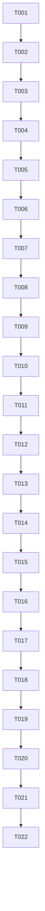

# Tasks: 按序最小修复与双包交付

**Input**：本目录spec.md、plan.md。根目录 `~/data/DSHM-deveco-workspace`，下列路径均相对根目录。

## Format

编号连续，[USn]对应故事，[P]仅表示可并行；本轮遵循用户优先顺序，所有实现串行，无[P]。描述中的P1/P2表示优先级。

## Path Conventions

源码只改问题相关落点；新证据位于 `dist/acceptance/fix-review-dual-release/`，保留历史交付及原始只读审查报告。阶段4只执行T001–T019，排除应用构建/部署；阶段5执行T020–T022。用户已选择不做UI验证。

## Phase 1: Setup

- [X] T001 P1 保全已有改动，记录版本/权限/签名配置文件摘要及核心实物基线，不输出口令，建立11项及附属错误处置表，目标 dist/acceptance/fix-review-dual-release/baseline.md
- [X] T002 P1 运行修改前同批门禁并核对当前CI补充范围，记录每条状态、受限与原有失败，不拿历史统计代替，目标 dist/acceptance/fix-review-dual-release/before.txt

## Phase 2: Foundational

- [X] T003 P1 建立问题级生产逻辑测试入口及安全fixture准则，确认SDK/API依据、官方默认行为与新门禁变异自检要求，禁止以手写同构模型冒充实现测试，目标 spec/fix-review-dual-release/test-contract.md

## Phase 3: User Stories — 用户指定顺序增量修复

> 阶段4收口：第四轮独立终核PASS，全部11候选及tmp已完成源码/生产行为验收；terminal-final同批113/0、CI22rc0。父会话专用静态已执行两轮，最新8条severity1仍引用旧源码形态，未冒称静态全绿，交T020真实编译核验。详见implementation-report.md最新节。

故事任务按用户指定跨故事排序，保留各故事独立验收；不因章节顺序重排实际优先级。

- [X] T004 [US1] P1 修DR1唯一探测对象拥有权与清理，预存原同名文件不变，成功/失败/授权短路/保守拒绝语义均测，目标 platform/src/main/ets/system/FilePicker.ets
- [X] T005 [US2] P1 修E01恢复完整npm名称版本/alias/Git意图，测试清单往返及默认保留本机差异版本，目标 platform/src/main/ets/sync/PluginRestore.ets
- [X] T006 [US3] P1 修B01失败/取消/重试/释放引用配平，核主调用方held与generation并保留PC常驻行为，目标 platform/src/main/ets/notify/KeepAlive.ets
- [X] T007 [US2] P1 修E04任务代次/锁拥有权及合作取消，覆盖runner、插件恢复、两壳与原生UI的进度/提交/完成回调，不承诺撤回已提交外部副作用，目标 platform/src/main/ets/sync/SyncEngine.ets
- [X] T008 [US2] P1 修E02每次拉取自动映射刷新和未映射统计/原因贯通UI，测试非空缓存新增目录及零项；不新增手动映射或写未知目录，目标 platform/src/main/ets/sync/ImportRunner.ets
- [X] T009 [US1] P1 修D01覆盖真实manager remove/install/recover的本地事务保旧，区分普通卸载和更新，不误复活；解决tmp错误，测试下载/验包/启用/落位失败和恢复双失败；若必须最小官方生命周期适配须证明本地不足且保留官方恢复，目标 hostcore/app/dshm-installer.js
- [X] T010 [US2] P1 修E03复用流式摘要核暂存及已有目标，等摘要幂等、异内容冲突不覆盖，缺摘要保持拒绝并说明，兼容官方有效格式，目标 platform/src/main/ets/sync/ImportRunner.ets
- [X] T011 [US2] P1 修E05完整unit及不可变快照资产身份，同一副本计算摘要/尺寸并登记，测试合法技能碰撞及同unit多快照，已登记路径不按批次盲删，目标 platform/src/main/ets/sync/SyncStore.ets
- [X] T012 [US3] P2 修C01以捕获worker退出作正常完成，QMP greeting/close/error不冒充退出，保留有界超时并明确未确认退出，测试重复stop及竞态，目标 hostcore/plugins/dshm-vm-bash/lib/vm.js
- [X] T013 [US1] P2 修FR1容器内容摘要stamp及旧/缺/损坏stamp安全迁移，走现有事务安装保护数据，测试同尺寸异内容和缺stamp跨尺寸，目标 hostruntime/src/main/ets/core/BundledCore.ets
- [X] T014 [US3] P2 修CR2卸载统计作用域并测试Cordis清理隔离不变，确认tmp附属错误已由T009覆盖，目标 hostcore/plugins/dshm-vm-bash/lib/index.js
- [X] T015 [US4] P1 审核Beta恢复机制，适配AGC为devecocli的release product/release模式，保留签名/profile/三端/输出核验，不实际出应用包，目标 tools/build-agc.mjs

**独立验收**：US1失败保已有文件/安装、核心身份真实；US2清单请求完整、取消隔离、遗漏可见、内容可核且资产不覆盖；US3引用配平、worker退出依据正确及清理日志有效；US4构建入口与恢复机制就绪，实际包由阶段5核验。

## Phase 4: Polish

- [X] T016 P1 重打核心及同步宿主/插件/manifest/resfile/OSS，验证单容器及所有修复源到实物一致，不删历史交付，目标 dist/acceptance/fix-review-dual-release/core-integrity.md
- [X] T017 P1 同口径全量回归和当前CI补充，运行全部新增行为与变异自检、必要ArkTS/C++静态检查，处理OK→BAD，目标 dist/acceptance/fix-review-dual-release/after.txt
- [X] T018 P1 委派独立只读研究者重新反证11项、附属错误、新风险和官方差异必要性；发现范围内问题修正后重测重物化，不以审查者口头保证代替证据，目标 spec/fix-review-dual-release/post-fix-review.md
- [X] T019 P2 更新必要当前状态及append-only记忆，移交修改文件、精确结果、官方改动清单、剩余边界和双包命令；未编译不得写包成功，目标 spec/fix-review-dual-release/implementation-report.md

## Phase 5: Verification

<!-- verification_scope: build-only -->

- [X] T020 P1 使用devecocli build显式选择所需模块完成真实编译及必要修复，初始循环最多10次；修复后复跑受影响行为/回归/独立复核，记录证据，目标 dist/acceptance/fix-review-dual-release/verification.md
- [X] T021 P1 通过既有入口顺序构建Beta与AGC三端合包，逐次核配置逐字恢复；核身份/版本/设备/18和9权限reason/核心及资源摘要/签名与Profile及可用的独立验签，留存两包路径大小SHA256，目标 dist/acceptance/fix-review-dual-release/delivery.md
- [X] T022 P1 探测设备后仅对可安全覆盖的Beta尝试devecocli run --skip-build，禁止卸载换签名及强行侧载AGC；信任拒绝即记受限，复跑包后必要检查与恢复核验后交付待测双包，不运行UI，目标 dist/acceptance/fix-review-dual-release/verification.md

阶段5收口：离线双包及回归PASS，总状态INCOMPLETE；T022设备已探测，但AGC覆盖缓存后无安全Beta绑定，故未执行run，不侧载正式包。勾选表示流程执行及受限结论已留证，不表示部署成功；见verification.md及delivery.md。

## 📊 Dependency Graph

## ⚡ Parallel Execution Guide

| Phase | Tasks | Required Files | Execution Notes |
|---|---|---|---|
| 全部 | T001–T022 | 见各项 | 按序实现，避免共享同步文件、核心物化或签名身份冲突；独立审查可由研究者只读进行但不并发源码改写 |

## Dependencies & Execution Order

顺序即T001至T022。任何核心/插件后改必须回到T016重物化，再跑T017及受影响独立复核。Beta与AGC不能并行，前一身份配置恢复后再构建后一种。阶段4不运行最终应用build/deploy。阶段5 scope=build-only，不包含verify_ui或UI测试。

## Parallel Example

本轮不设置[P]任务；并行仅限独立只读研究和互不干扰的测试，不改变批准修复优先次序。

## Implementation Strategy

先保全和基线，再优先修数据安全及明确错误；必要共享摘要基础能力随相关任务建立。官方核心非必要不改，任何必要差异以当前真实可达链证明。不提交、不重置、不改变应用版本、权限、设备矩阵或签名，不上传AGC。通过修复后反证与回归后才进入双包编译核验；设备受限不冒报通过，仍交付离线合格待测包。

## Notes

共22项：Setup2、Foundational1、故事12（US1 3、US2 5、US3 3、US4 1）、Polish4、Verification3。P1共18项、P2共4项，无并行标记。编号和路径已核；任务完成勾选表示实际执行且有证据，部署受限不代表通过。不得采用模板中的默认提交行为。
