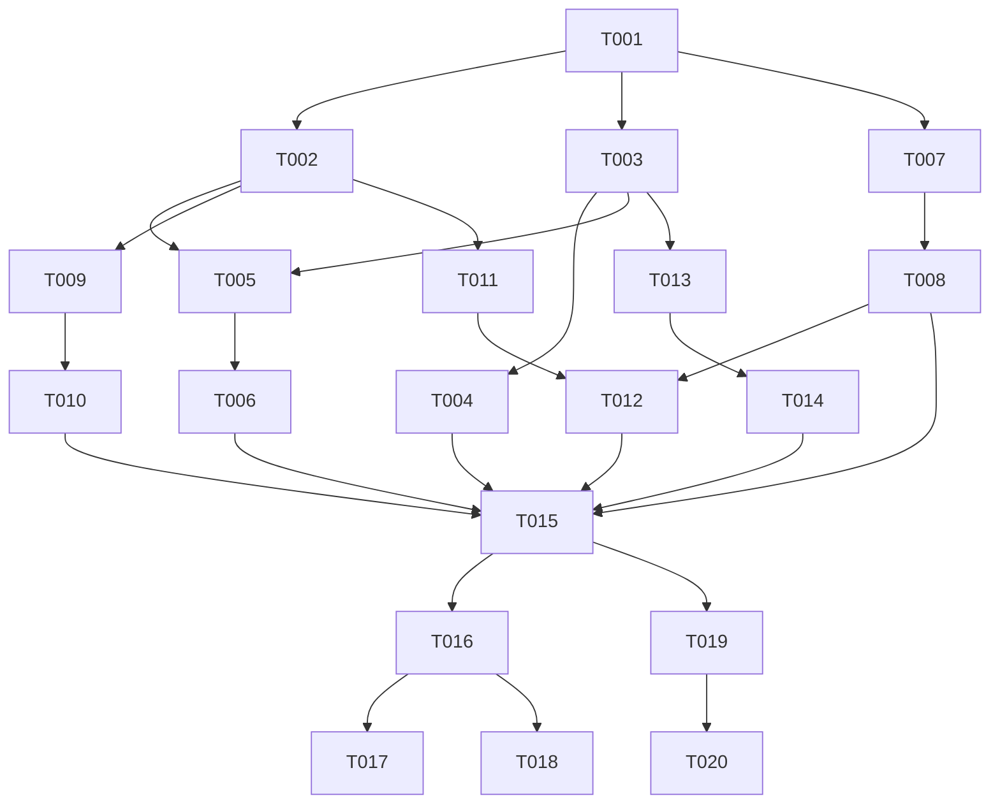

# Tasks: 鸿蒙 PC 开发环境深度适配

**Input**: Design documents from `spec/hmpc-dev-adaptation/`
**Prerequisites**: plan.md, spec.md
**Verification scope**: build-only（装机被签名阻塞 OQ-1、手机/平板离线；装机与 UI 闭环入晨间清单）

## Format: `[ID] [P?] [Story] Description`

- **[P]**: 可并行（不同文件、无未完成依赖）；**[Story]**: 对应 spec.md 的 US1–US8

## Path Conventions

- 工具一律落 `tools/`（既有 97 个 .mjs 惯例），共享库落 `tools/lib/`
- 文档落 `docs/`（编号顺延 212）；产物/证据落 gitignored 的 `dist/`（logs/acceptance/core/work）
- 本特性不触碰 `entry/src/main/ets`（应用代码零改动）

---

## Phase 1: Setup

- [ ] T001 记录改动前基线到 `dist/logs/hmpc-baseline.md`：4 条已绿轻量门禁（check-permission-surface / check-no-apk-surface / check-deveco-paths --self-test / check-doc-refs）+ git status --short 快照 + 现有构建产物 `entry/build/default/outputs/default/entry-default-unsigned.hap` 的 sha256/大小（回归纪律：先跑基线）

## Phase 2: Foundational

- [ ] T002 [P] 新建共享库 `tools/lib/hdc-client.mjs`（plan C2）：resolveHdc()（DSHM_HDC → devecoPath('sdk/default/openharmony/toolchains/hdc') → PATH hdc）、listTargets()（[Empty]→[]）、runHdc(hdc,target,args)（target 非空自动 -t；spawnSync Buffer 宿主侧捕获）；零副作用；注释注明多设备 -t / bm dump 宿主侧捕获 / 编码坑出处

**Checkpoint**: 装机/验收/指纹三工具可并行移植

## Phase 3: User Story 1 - DevEco 根解析 (P1) 🎯

**Independent Test**: 免环境变量 resolveDevecoRoot() 非 null 且根下有 hvigor/bin/hvigorw.js；DEVECO_ROOT_MARKER 导出不变

- [ ] T003 [P] [US1] 扩展 `tools/lib/deveco-home.mjs`（plan D1/C1）：新增 DEVECO_ROOT_MARKER_CLT='hvigor/bin/hvigorw.js'；isDevecoRoot() 两判据任一命中；候选列表在 DEVECO_HOME 后追加 ~/devecostudio/Contents（os.homedir() 展开）与 /data/service/hnp/hmos-clt.org/hmos-clt_1.0.0；Windows 候选顺序与导出面零改动
- [ ] T004 [US1] 验证解析契约：免环境变量 resolveDevecoRoot() 返回 HM PC 根；DEVECO_HOME 覆盖生效；DEVECO_ROOT_MARKER 仍为 tools/hvigor/bin/hvigorw.js；`node tools/check-deveco-paths.mjs --self-test` 保持绿

## Phase 4: User Story 2 - 装机链 (P1)

**Independent Test**: 构建段真跑（debug 全链）；装机段工具就绪（真装晨间 OQ-1 后）

- [ ] T005 [US2] 移植 `tools/update-device.ps1` → `tools/update-device.mjs`（plan C3 逐项）：--target/--skip-build/--hap/--build-mode；流程=零 uninstall 自检→设备确认（hdc-client）→数据基线（home 链接数/文件数）→构建（hvigorw 经 deveco-home 解析）→定位 HAP→读 debug 标志→hdc install -r 三态判定（回空→重试→bm dump updateTime 正判）→冷启动→数据保全校验→分档就绪判定；fail-fast；.ps1 判据注释逐条保留
- [ ] T006 [US2] 验证装机链：--help 契约；零卸载自检过；构建段真跑（ArkTS 0 错误 + unsigned HAP 产出）；装机/校验段代码完整（真装晨间执行）

## Phase 5: User Story 4 - 核心树重建 (P2)

**Independent Test**: 条目数 40,768 全验 + 树依赖门禁可运行

- [ ] T007 [P] [US4] 解压重建核心树：解压脚本（python3 zipfile，plan D4）写到仓库外 `/data/storage/el2/base/temp/deveco/`，把 `entry/src/main/resources/resfile/dsh-core-0.2.1-rc.2+dshm.78-openharmony-arm64.zip` 解到 `dist/core/work/`（zip 顶层即版本目录）；执行后删临时脚本
- [ ] T008 [US4] 验证树+树依赖门禁：断言 `dist/core/work/dsh-core-0.2.1-rc.2+dshm.78/` 条目 40,768；逐条跑树依赖门禁（check-core-openharmony-patches、assert-core-entrypoints、check-ptc-wiring、compat-drift、assert-fs-search-fallback、check-web-fetch-jitless、check-ptc-runtime-inproc、check-undici-shim-exports、check-fs-local-permission、check-agent-instructions-scope-walk、check-plugin-toggle、check-native-closure），读数记入 `dist/logs/hmpc-gates-baseline.md`；红项定性（迁移引入 vs 既有，对照 docs/210 基线）

## Phase 6: User Story 5 - 端侧验收移植 (P2)

**Independent Test**: 本机 --skip-install 跑通，report.md 自动判定表齐全

- [ ] T009 [P] [US5] 移植 `tools/device-acceptance.ps1` → `tools/device-acceptance.mjs`（plan C4 逐项）：--skip-install/--target/--boot-wait-seconds/--hilog-early-seconds；bundle 从 build-profile.json5/AppScope/app.json5 解析；强制冷启动；判据=设备侧持久日志（node-output.log 轮转、dshm-host.log 截"写锁巡检"后，E385）；UI 按文本定位（E261）；证据落 `dist/acceptance/<时间戳>/`；report.md 五项自动判定；零卸载
- [ ] T010 [US5] 本机（127.0.0.1:45595）验证：--skip-install 跑通（冷启动+采证+report.md+nav.md）；零 uninstall；目录结构与 .ps1 契约一致

## Phase 7: User Story 6 - 代码指纹移植 (P2)

**Independent Test**: 三态结论/退出码 0/1/2 契约逐条核

- [ ] T011 [P] [US6] 移植 `tools/device-code-fingerprint.ps1` → `tools/device-code-fingerprint.mjs`（plan C5 逐项+D3 修正）：--token/--port/--timeout-sec/--local-tree；filesDir 按解析出的 bundle 拼（修正 .ps1 写死 com.dshm.dshclient 的缺陷，注释留档）；token 三级优先（命令行>host-ready.json>日志按 boot 段三级，来源打进输出）；端口从 `entry/src/main/ets/runtime/RuntimePort.ets` 的 HOST_DEFAULT_PORT+候选探测；fport 失败清理；13 个关键文件清单逐字一致；设备侧只读
- [ ] T012 [US6] 本机验证指纹工具：三态/退出码（0/1/2）；token 来源行；本机树对照用 T007 的 `dist/core/work/dsh-core-0.2.1-rc.2+dshm.78/`

## Phase 8: User Story 7 - 发布签名移植 (P3)

**Independent Test**: 物料存在性 + unsigned 输入契约 + 摘除段 dry-run（真签晨间补口令 OQ-2）

- [ ] T013 [P] [US7] 移植 `tools/sign-release-hap.ps1` → `tools/sign-release-hap.mjs`（plan C6 逐项）：--in-file/--out-file/--keystore/--cert/--profile/--key-alias/--pwd/--note-file/--sign-alg；物料默认 `~/data/AGC-operations/release-signing/`（已核实三件在位）；输入必须 unsigned；签名前调 `tools/strip-ungranted-acl-perms.mjs` 摘未授权 ACL（幂等）；hap-sign-tool 经 resolveDevecoSdkHome() 解析；verify-app 复验 + type=release 断言；产物 sha256 打印
- [ ] T014 [US7] 验证就绪度：物料检查过；非 unsigned 拒绝路径正确；摘除段 --dry-run 可跑；真签留晨间

## Phase 9: User Story 3 - 门禁全绿基线 (P1)

- [ ] T015 [US3] 全量门禁基线：按 `.github/workflows/gates.yml` 顺序逐条跑（先 `node tools/place-host-app.mjs` 再 assert-resfile-sync）；仓库内 ~37 条 + 树依赖（T008 汇总）退出码/读数全记 `dist/logs/hmpc-gates-baseline.md`；断言 0 红；红项定性（本轮引入→当场修；既有→登记）

## Phase 10: User Story 8 - 晨间清单 (P3)

- [ ] T016 [US8] 写 `docs/212-鸿蒙PC开发环境适配与晨间签名清单.md`（plan C7）：①本轮适配事实（环境读数/构建验证/门禁基线/工具用法表）②GUI 自动签名步骤（DevEco Studio 自动生成签名选 com.dshm.dshmbeta；预期读数=~/.ohos/config 出现 dshmbeta profile）③签名一致性决策点（OQ-1：新身份 install -r 预期签名不一致→选项呈现：接受卸载重装[beta 数据丢失]/保留旧签/其他，用户拍板）④装机验收闭环命令序列（update-device.mjs→device-acceptance.mjs→device-code-fingerprint.mjs）⑤发布签名口令补齐（OQ-2）

## Phase 11: Polish

- [ ] T017 [P] 更新 `docs/README.md` 导航：按既有格式补 docs/212 条目
- [ ] T018 清理：删 `/data/storage/el2/base/temp/deveco/` 临时解压脚本；对照基线确认 `tools/` 只新增预期文件（hdc-client.mjs + 4 个移植工具）、.ps1 原版全在

## Phase 12: Verification

<!-- verification_scope: build-only -->

- [ ] T019 全量重建验证：构建全链（hvigorw assembleHap debug 或 devecocli build）；断言 ArkTS 0 错误 + `entry/build/default/outputs/default/entry-default-unsigned.hap` 产出 + 条目数与基线一致；SignHap 00303107（占位签名料）为**预期失败**——记录不修（晨间 GUI 签名解决）；产物 sha256 记入 `dist/logs/hmpc-baseline.md`
- [ ] T020 部署就绪度验证（build-only 口径）：经 hdc-client 确认设备在线（127.0.0.1:45595）；bm dump 只读基线（已装包清单）；update-device.mjs 装机路径就绪；真机 install -r 晨间 OQ-1 拍板后执行（docs/212 §闭环）

---

## 📊 Dependency Graph



## Dependencies & Execution Order

- **Setup（T001）**: 无依赖，立即开始；基线必须先于一切改动（回归纪律）
- **Foundational（T002）与 US1（T003）**: T001 后并行（不同文件）
- **US4（T007）**: T001 后即可并行（纯解压，与代码改动无关）
- **US 移植（T005/T009/T011/T013）**: 各自依赖 T002/T003 完成后并行（各自独立文件）
- **验证段（T004/T006/T008/T010/T012/T014）**: 依赖各自实现任务；T012 额外依赖 T008（本机树）
- **T015 门禁基线**: 依赖全部实现与验证任务（它反向验证一切）
- **T016 晨间清单**: 依赖 T015（清单要引基线读数）；T017/T018 依赖 T016
- **T019/T020 验证**: T015 后收口

## ⚡ Parallel Execution Guide

| Phase | Tasks | Required Files | Execution Notes |
|---|---|---|---|
| Setup/Foundational | T002, T003, T007 | tools/lib/hdc-client.mjs / tools/lib/deveco-home.mjs / dist/core/work/ | 三者互不依赖，T001 后全并行 |
| US 移植 | T005, T009, T011, T013 | 4 个新 .mjs（tools/） | 各自独立文件；同依赖 T002/T003，可全并行 |
| 验证段 | T006, T010, T012, T014 | 只读 + dist/logs | 依赖各自移植任务；T012 另需 T008 |
| 收尾 | T017, T018 | docs/README.md / temp | T016 后并行 |

## Parallel Example

```bash
# T001 完成后，三个无依赖任务并行：
Task: "T002 [P] 新建 tools/lib/hdc-client.mjs"
Task: "T003 [P] [US1] 扩展 tools/lib/deveco-home.mjs"
Task: "T007 [P] [US4] 解压重建核心树"

# Foundational 就绪后，四个移植任务并行：
Task: "T005 [US2] tools/update-device.mjs"
Task: "T009 [P] [US5] tools/device-acceptance.mjs"
Task: "T011 [P] [US6] tools/device-code-fingerprint.mjs"
Task: "T013 [P] [US7] tools/sign-release-hap.mjs"
```

## Implementation Strategy

### MVP First（T001–T006）

1. Setup 基线 → Foundational（hdc-client）∥ US1（解析口）→ US2（装机链）
2. **STOP and VALIDATE**: 免环境变量解析出根 + 装机链构建段真跑 = 核心工作流恢复
3. 增量交付：US4 树重建 → US5/US6/US7 工具移植 → US3 门禁基线 → US8 清单 → 验证收口

### 增量交付

每完成一个 US 即独立可验（见各 Phase 的 Independent Test）；全部完成后 T015 全量基线兜底"项目没被改坏"。

## Notes

- 红线：全程零卸载、不碰 ~/.ohos、git 脏树保持、.ps1 原版不删
- 既有红如实登记定性，不静默；本轮引入的红当场修
- 总任务 20（含验证 2）；每故事 1–2 任务；MVP = T001–T006
