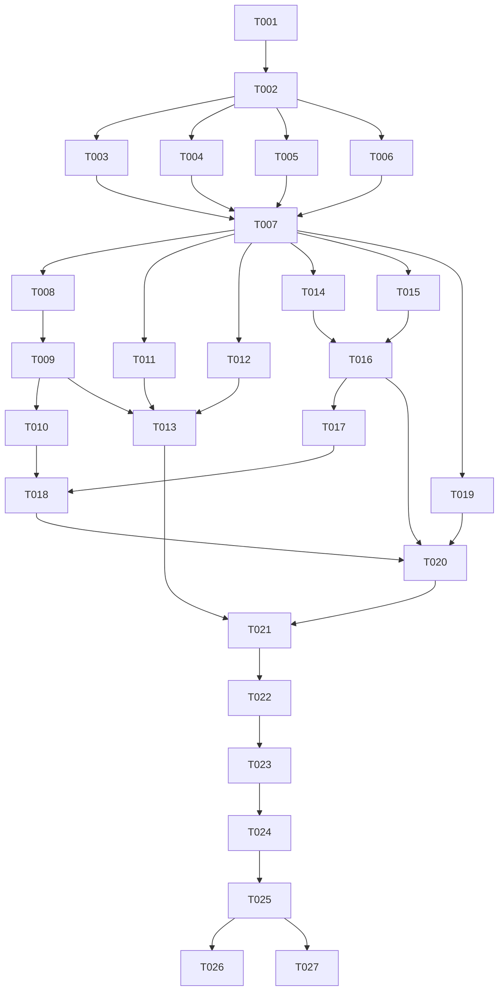

# Tasks: 沉浸光感 + 碰一碰传文件双 Demo（全机制复刻）

**Input**: Design documents from `spec/immersive-knock-demo/`
**Prerequisites**: plan.md (required), spec.md (required for user stories)

## Format: `[ID] [P?] [Story] Description`

- **[P]**: 可并行（不同文件、无未完成依赖）
- **[Story]**: 对应 spec.md 用户故事（US1–US5）
- 描述含精确文件路径

## Path Conventions

- **demo 工程**: `demo/` 为 untracked 独立工程根（脚手架生成），任务路径均为仓库根相对路径（如 `demo/entry/src/main/ets/...`）
- **rawfile 资产**: `demo/entry/src/main/resources/rawfile/`（两 HTML + 内置样例文件）
- **spec 工件**: `spec/immersive-knock-demo/`（spec.md / plan.md / tasks.md）
- **生产源（只读移植锚点）**: `entry/src/main/ets/pages/WebApp.ets`、`entry/src/main/ets/system/KnockShareReceiver.ets`、`platform/src/main/ets/ui/ImmersiveMaterialKit.ets`——只读对照，一律不改

---

## Phase 1: Setup (Shared Infrastructure)

- [X] T001 用 `devecocli create --app-name dshm-demo --project-path demo --bundle-name com.dshm.dshdemo` 脚手架生成 demo/ 独立工程（生产模块/配置零改动；目标目录须为空）
- [X] T002 对齐工程身份与 API 面：demo/build-profile.json5 的 SDK 面设为 min 6.1.0(23) / target 26.0.0（对齐生产 build-profile.json5 口径）；demo/AppScope/app.json5 设 version 1.0.0 / label "DSHM Demo"；demo/entry/src/main/module.json5 清空 requestPermissions（0 条）并设 deviceTypes 为 tablet/2in1/phone

---

## Phase 2: Foundational (Blocking Prerequisites)

**⚠️ CRITICAL**: 本阶段完成前不得开始任何用户故事。

- [X] T003 [P] 创建 demo/entry/src/main/ets/model/DemoTypes.ets：KnockFile{name,mime,size,base64}、WebContextMenuItem{label,run}、WebContextMenuPanelParams{items,themeDark}、ThemeMode(System/Light/Dark)
- [X] T004 [P] 创建 demo/entry/src/main/ets/common/DemoTheme.ets：themeMode 状态（默认 System）+ themeDark(mode, systemColorMode) 显式求值（材质明暗不用 SYSTEM 档，生产纪律）
- [X] T005 [P] 创建 demo/entry/src/main/ets/service/Diag.ets：material/webmenu/knock 三探针，追加式 ISO 时间戳行写 filesDir 下 diag-material/diag-webmenu/diag-knock
- [X] T006 [P] 创建 demo/entry/src/main/ets/service/DemoMaterialKit.ets：逐位移植 platform/src/main/ets/ui/ImmersiveMaterialKit.ets——dialogMaterial()（THICK 非交互）/menuMaterial(themeDark)（THIN 显式明暗）/immersiveMaterialOf 及三包装；API≥26 判定与构造异常兜底（undefined）必须在实参求值前
- [X] T007 改写 demo/entry/src/main/ets/entryability/EntryAbility.ets：主窗加载 pages/Index；onConfigurationUpdate 跟踪系统明暗喂 DemoTheme；启动一次性写 diag-material 能力读数（sdk/supported/level；API<26 记 below26）

**Checkpoint**: 基础层就绪（类型/主题/诊断/材质/入口），用户故事可开始。

---

## Phase 3: User Story 1 - 沉浸光感材质弹窗 (Priority: P1) MVP

**Goal**: 4 形态按钮弹出 THICK 玻璃弹窗，API≥26 挂材质/<26 纯色兜底/异常兜底不崩。
**Independent Test**: 点任一弹窗按钮即可独立演示与验收。

- [X] T008 [US1] 创建 demo/entry/src/main/ets/viewmodel/ImmersiveDemoViewModel.ets：弹窗 4 形态动作——逐位对齐生产 4 处（WebApp.ets :4658-4683 确认类双按钮 / :5018 / :5048 / :5127），材质经 DemoMaterialKit.dialogMaterial()，文案改 demo 演示语境（FR-002/FR-003）
- [X] T009 [US1] 创建 demo/entry/src/main/ets/views/ImmersiveDemoView.ets：弹窗按钮区（4 按钮）+ 挂 ImmersiveDemoViewModel（本故事不含 Web 演示区）
- [X] T010 [US1] 改写 demo/entry/src/main/ets/pages/Index.ets：Tabs 双页签骨架 + 主题切换（System/Light/Dark，接 DemoTheme）+ 沉浸页签接线 ImmersiveDemoView；碰一碰页签暂占位

**Checkpoint**: US1 可独立演示（MVP 增量：4 形态玻璃弹窗）。

---

## Phase 4: User Story 2 - 网页菜单原生接管 (Priority: P1)

**Goal**: 本地演示页五类对象长按/右键出 THIN 玻璃语境菜单，空集回退系统菜单。
**Independent Test**: 对演示区五类对象（链接/图片/输入框/选区/空白）分别长按即可独立验收。

- [X] T011 [P] [US2] 创建 demo/entry/src/main/resources/rawfile/immersive-demo.html：离线五类对象页——链接（IANA 保留示例域）/图片（内嵌 data URI）/可编辑输入框/可选中文本段/空白区；无外部资源引用
- [X] T012 [P] [US2] 创建 demo/entry/src/main/ets/service/WebMenuHost.ets：接管链逐位移植（WebApp.ets :7311-7452 + 面板 :195-225）——buildMenuItems 语境判定（link/image/editable 位掩码/纯选区/空集 handled=false 回退）、坐标负值回退、动作映射（打开链接拉系统浏览器/复制剪切粘贴全选走 ArkWeb result/复制图片/保存图片按 API 存在性 typeof 守卫）、WebContextMenuPanel @Builder（WithTheme{Menu{ForEach}}）+ ComponentContent/wrapBuilder 面板构造、THIN 材质仅 API≥26 求值、diag-webmenu 全链标记
- [X] T013 [US2] 扩展 demo/entry/src/main/ets/views/ImmersiveDemoView.ets 与 demo/entry/src/main/ets/viewmodel/ImmersiveDemoViewModel.ets：挂 Web 组件加载 $rawfile('immersive-demo.html') + onContextMenuShow 接线 WebMenuHost + 菜单锚定触点坐标弹出 + 主题明暗接 DemoTheme

**Checkpoint**: US1+US2 独立可演示（沉浸光感完整）。

---

## Phase 5: User Story 3 - 碰一碰模拟（单机必现） (Priority: P1)

**Goal**: 「模拟碰一碰」按钮（内置样例/文件选择器）走与真实接收完全相同的注入管线，chip 进输入框。
**Independent Test**: 单机点按钮即可看到 chip 进输入框。

- [X] T014 [P] [US3] 创建 demo/entry/src/main/resources/rawfile/knock-demo.html 与 demo/entry/src/main/resources/rawfile/demo-sample.txt：HTML 实现 file-intake（document 级 paste/drop 监听 → 附件 chip（文件名/大小）进输入区、chip 可 ×移除、不自动发送，FR-008）；样例文件为小体积内置演示载荷
- [X] T015 [P] [US3] 创建 demo/entry/src/main/ets/service/KnockShim.ets：SHIM_SCRIPT 逐位移植 KNOCK_SHIM_JS（WebApp.ets :3393——window.__DSHM_KNOCK__ 防重入/toFile/dispatchPaste 合成 ClipboardEvent('paste') 带 DataTransfer/退 DragEvent('drop')/[dshm-knock] 日志/unrouted 留痕）+ injectFile(controller, KnockFile) 唯一注入入口（runJavaScript 载荷注入，paste→drop→unrouted 语义 + diag-knock 标记，FR-007）
- [X] T016 [US3] 创建 demo/entry/src/main/ets/viewmodel/KnockDemoViewModel.ets：模拟管线编排——内置样例（rawfile 读取）/DocumentViewPicker 选真实文件两来源 → 16MiB 校验（超限跳过留痕）→ KnockFile → KnockShim.injectFile 同一出口（FR-009）；挂起队列（cap 10）+ takePending/requeue 补发编排
- [X] T017 [US3] 创建 demo/entry/src/main/ets/views/KnockDemoView.ets：Web 组件加载 $rawfile('knock-demo.html') + javaScriptOnDocumentStart 注册 SHIM_SCRIPT（scriptRules ['*']）+ 「模拟碰一碰（内置样例）/（选文件）」按钮×2 + 挂起/状态行
- [X] T018 [US3] 扩展 demo/entry/src/main/ets/pages/Index.ets：碰一碰页签接线 KnockDemoView（替换占位）

**Checkpoint**: US1–US3 独立可演示（单机全量 P1：弹窗+菜单+模拟碰一碰）。

---

## Phase 6: User Story 4 - 碰一碰真实接收（双机） (Priority: P2)

**Goal**: Share Kit 真实接收全机制（守卫/退避/队列/清理），与模拟同一注入出口。
**Independent Test**: 有第二台设备时碰一碰即可验收；单机可验注册诊断标记。

- [X] T019 [P] [US4] 创建 demo/entry/src/main/ets/service/DemoKnockShareReceiver.ets：逐位移植 entry/src/main/ets/system/KnockShareReceiver.ets 全机制——canIUse('SystemCapability.Collaboration.HarmonyShare') 守卫/主窗注册/1-2-4-8s 退避至多 5 次/幂等 start-stop/receiveUri=demo filesDir/落盘记账与 onResult 后按 uri 清理（不删目录）/单文件 16MiB/挂起队列 cap 10/takePending-requeue/diag-knock 全链标记；去 desktopForced 门控并以注释注明「生产仅 PC 档注册，demo 无形态矩阵不门控（FR-010）」
- [X] T020 [US4] 扩展 demo/entry/src/main/ets/viewmodel/KnockDemoViewModel.ets：DemoKnockShareReceiver 生命周期接线（页面就绪后注册，非 aboutToAppear）+ onDelivered → 读落盘 → KnockFile → 与模拟同一 injectFile 出口 + 注册状态（unsupported/registering/registered/failed）展示 + 页面重载窗口挂起补发

**Checkpoint**: 全部用户故事功能就位。

---

## Phase 7: User Story 5 - 诊断探针复刻 (Priority: P3)

**Goal**: 三探针全链标记按 spec 验收场景齐备。
**Independent Test**: 设备文件管理器/终端读取 filesDir 三个 diag 文件。

- [X] T021 [US5] 诊断探针全链核验补齐（落点：demo/entry/src/main/ets/ 下各 service/view）：对照 spec US5 三验收场景逐标记核查——diag-material 启动读数（T007 已落）/diag-webmenu（show/fallback/open/appear/dismiss/item 全链）/diag-knock（注册/重试/接收/注入/unrouted）；缺标记处于对应文件补齐

---

## Phase 8: Polish & Cross-Cutting Concerns

- [X] T022 [P] 清理 demo/ 脚手架残留与无用资源（保留 rawfile 三资产：immersive-demo.html/knock-demo.html/demo-sample.txt；删除脚手架示例页与未引用资源）
- [X] T023 FR-001~013 逐条对照自查（范围：demo/ 全域 + 仓库根生产面）：权限面 0 条核验、生产模块/配置零改动核验（FR-001）、材质守卫实参求值前（FR-003）、明暗显式指定（FR-004）、门控差异注释（FR-010）、移植锚点注释完备性；发现偏差就地修复

---

## Phase 9: Verification

<!-- verification_scope: build-only -->

**Purpose**: demo 静态检查 + 独立构建绿 + 生产 131 门禁重跑全绿 + 部署尝试（环境受限如实记录）。

- [X] T024 对 demo 全部 .ets 跑静态检查（check_ets_files：model/common/service/viewmodel/views/pages/entryability 全部文件），修复静态错误
- [X] T025 demo 独立构建修至绿：在 demo/ 内执行 `devecocli build`（demo 独立 hvigor 根），迭代修复直到产出调试签名 hap；构建上下文切换到 demo/（switch_cwd），与生产构建隔离
- [X] T026 [P] 生产 131 全量门禁重跑（仓库根执行）：`python3 dist/acceptance/rerun-gates.py dist/acceptance/20261117-full-yml-gates-sweep.txt dist/acceptance/20261117-immersive-knock-demo-gates.txt`，必须 0 失败（FR-013/SC-003；环境受限门禁不作判据）
- [X] T027 [P] 部署尝试：`devecocli run --skip-build`（或对产出的 demo hap 执行覆盖安装）；本机无 hdc 时如实记录「环境受限：无法部署」（AGENTS §8 交付上限 = 离线门禁 + 包结构），不判为失败

---

## Dependencies & Execution Order

### Phase Dependencies

- **Setup (Phase 1)**: T001 → T002 严格顺序，无外部依赖
- **Foundational (Phase 2)**: 依赖 Setup；T003–T006 四文件并行，T007 汇接；**BLOCKS 全部用户故事**
- **User Stories (Phases 3–7)**: 均依赖 Foundational 完成
- **Polish (Phase 8)**: 依赖全部用户故事完成（T021）
- **Verification (Phase 9)**: 依赖 Polish（T023）

### User Story Dependencies

- **US1 (P1)**: Foundational 后即可开始，不依赖其他故事
- **US2 (P1)**: Foundational 后即可开始；T013 接线依赖 T009（视图已建），与 US1 部分交叠但可独立测试
- **US3 (P1)**: Foundational 后即可开始；T018 接线依赖 T010（Index 已建）
- **US4 (P2)**: T019 仅依赖 Foundational（可与 US2/US3 并行）；T020 依赖 T016+T018+T019
- **US5 (P3)**: 依赖 US2/US4 探针落点全就位（T013+T020）

### Within Each User Story

- 模型/类型先于服务，服务先于视图，视图先于接线
- 每个故事完成后须可独立测试（Independent Test）再进入下一优先级
- 移植类任务（T006/T012/T015/T019）以生产源为只读对照，逐位保真

### Parallel Opportunities

- Foundational：T003 ∥ T004 ∥ T005 ∥ T006
- US2：T011 ∥ T012
- US3：T014 ∥ T015；US4 的 T019 可与整个 US3 段并行
- 验证尾段：T026 ∥ T027

### 📊 Dependency Graph



### ⚡ Parallel Execution Guide

| Phase | Tasks | Required Files | Execution Notes |
|---|---|---|---|
| Setup | T001 → T002 | demo/ 脚手架产物 | 严格顺序；T002 后 demo 为可构建空壳 |
| Foundational | T003 ∥ T004 ∥ T005 ∥ T006 → T007 | model/ common/ service/ entryability | 四文件互不依赖；T007 汇接三依赖 |
| US1 | T008 → T009 → T010 | viewmodel/ views/ pages/ | 链式；T010 完成 = MVP |
| US2 | T011 ∥ T012 → T013 | rawfile/ service/ views+viewmodel 扩展 | T011/T012 并行；T013 为接线 |
| US3 | T014 ∥ T015 → T016 → T017 → T018 | rawfile×2 / service/ viewmodel/ views/ pages 扩展 | T014/T015 并行；T018 与 T019 可并行 |
| US4 | T019 → T020 | service/ viewmodel 扩展 | T019 仅依赖 Foundational，可提前并行 |
| US5 | T021 | 各探针落点文件 | 全标记核验补齐 |
| Polish | T022 → T023 | demo/ 全域 | 先清理后自查 |
| Verification | T024 → T025 →（T026 ∥ T027） | demo/ + 仓库根 | 静态→构建→门禁∥部署尝试 |

---

## Parallel Example

```text
# Foundational 四任务并行（不同文件，无依赖）：
Task: "T003 [P] 创建 demo/entry/src/main/ets/model/DemoTypes.ets"
Task: "T004 [P] 创建 demo/entry/src/main/ets/common/DemoTheme.ets"
Task: "T005 [P] 创建 demo/entry/src/main/ets/service/Diag.ets"
Task: "T006 [P] 创建 demo/entry/src/main/ets/service/DemoMaterialKit.ets"

# US2 两任务并行：
Task: "T011 [P] [US2] 创建 rawfile/immersive-demo.html"
Task: "T012 [P] [US2] 创建 service/WebMenuHost.ets"
```

---

## Implementation Strategy

### MVP First (US1 Only)

1. Complete Phase 1: Setup（T001–T002）
2. Complete Phase 2: Foundational（T003–T007，BLOCKS 全部故事）
3. Complete Phase 3: User Story 1（T008–T010）
4. **STOP and VALIDATE**: 点 4 形态按钮独立验收玻璃弹窗
5. 构建绿即可交付首个可演示增量

### Incremental Delivery

1. Setup + Foundational → 基础层就绪
2. + US1 → 4 形态玻璃弹窗（MVP）→ 独立验收
3. + US2 → 五类对象语境玻璃菜单 → 沉浸光感完整
4. + US3 → 模拟碰一碰单机链路 → P1 全量
5. + US4 → 真实接收（双机）→ P2
6. + US5 → 诊断探针齐备 → Polish → Verification

### Parallel Execution Strategy

- 单执行者按 T001→T027 顺序执行（编号即执行序）
- 多执行者：Foundational 四任务并行铺开；T019（接收器移植）可独立分派与 US3 段并行

---

## Notes

- [P] 任务 = 不同文件且无未完成依赖
- [Story] 标签映射 spec.md 用户故事，可追溯
- 每故事须独立可完成、可测试；故事间接线仅经既有落点文件（Index/视图/VM）
- 总任务 27：Setup 2 / Foundational 5 / US1 3 / US2 3 / US3 5 / US4 2 / US5 1 / Polish 2 / Verification 4
- 独立测试标准：US1 点弹窗按钮 / US2 五类对象分别长按 / US3 单机点模拟按钮看 chip / US4 双机碰一碰（单机看注册标记）/ US5 读 filesDir 三 diag 文件
- MVP 建议：T001–T010（首个可演示增量）；完整 P1 演示 = 加 T011–T018
- 验证范围：build-only（demo 静态 + 构建绿 + 生产 131 门禁重跑全绿 + 部署尝试按环境受限如实记录）
- 本任务清单不生成测试任务（spec 未要求 TDD）；验收以各故事 Independent Test + Verification 阶段为准
