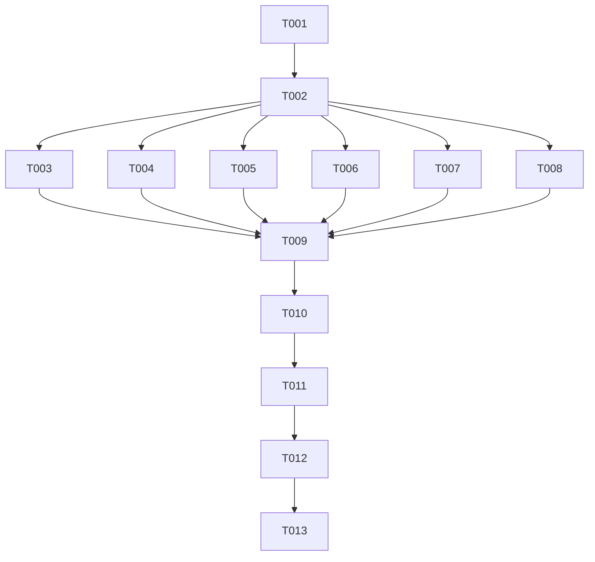

# Tasks: 当前源码独立功能审查

**Input**：本目录 spec.md、plan.md。根目录 `~/data/DSHM-deveco-workspace`，下列报告路径相对根目录。

## Format

任务编号连续；[P] 表示可并行，[US1]/[US2] 对应用户故事。所有任务优先级 P1。源码仅只读目标，不产生源码补丁。

## Path Conventions

唯一报告目录为 `spec/source-functional-review/`，不得写 docs、memory、acceptance、资源或其他目录。已获批五阶段只读例外：阶段 4 审查、阶段 5 证据复核；无 build/deploy/UI/fix 任务。

## Phase 1: Setup

- [X] T001 记录只读边界与当前入口覆盖基准，不读取历史结论，不输出凭据，验收为写入授权边界清晰，目标 spec/source-functional-review/coverage.md

## Phase 2: Foundational

- [X] T002 明确证据分级、严重性及无副作用检查准入准则，验收为候选问题结构统一且不能由旧绿灯推定正确，目标 spec/source-functional-review/review.md

## Phase 3: User Story 1 — 六域独立审查（P1）

**独立验收**：每域有可达入口、已查调用链、候选证据、反证检查及未覆盖项。不得为凑数量报告问题。

- [X] T003 [P] [US1] 审查两侧 WebApp、DeviceFacts、窗口/输入及当前核心侧栏，追踪设备分支、侧栏输入返回与桥注册，目标 spec/source-functional-review/domain-a-ui.md
- [X] T004 [P] [US1] 审查两侧 EntryAbility、DshHost/NodeRuntime、会话连接及后台通知，重点异步状态与生命周期，目标 spec/source-functional-review/domain-b-lifecycle.md
- [X] T005 [P] [US1] 审查 RuntimePort、vm-bash、PTY/VM/QGA及原生边界，追踪模式下发、取消与资源回收，目标 spec/source-functional-review/domain-c-terminal.md
- [X] T006 [P] [US1] 审查文件选择授权、工作区文件插件、安装解包及市场/profile桥，追踪失败传播与数据处理，目标 spec/source-functional-review/domain-d-files-plugins.md
- [X] T007 [P] [US1] 审查 HuaweiCloud、云同步界面/插件、SyncEngine/Store、上传导入及插件恢复，检查账号与异步隔离，目标 spec/source-functional-review/domain-e-sync.md
- [X] T008 [P] [US1] 审查 BundledCore/CoreStore、main、配方/profile/pack及实际核心契约，检查安装切换回滚和真实装配，目标 spec/source-functional-review/domain-f-core.md

## Phase 4: User Story 2 — 候选汇总与跨域反证（P1）

**独立验收**：每候选具备源码位置、触发条件、影响端、调用可达性、证据等级与反证；合并同根因项。

- [X] T009 [US2] 汇总六域候选，复查跨域生产者消费者、保护分支、调用者约束及当前上游实现，去重并分级，不实施修复，目标 spec/source-functional-review/review.md
- [X] T010 [US2] 整理覆盖矩阵与限制，记录安全检查执行或未执行原因，未深审项明示，目标 spec/source-functional-review/coverage.md

## Phase 5: Polish

- [X] T011 审核候选证据完整性与只读边界，交接所有待复核项及精确位置，不写修复代码，目标 spec/source-functional-review/review.md

## Phase 6: Verification — 独立只读证据复核

<!-- verification_scope: source-review+side-effect-free-checks -->
<!-- 用户明确批准替换默认build/deploy/UI流程；本标记不授权应用或设备操作。 -->

- [X] T012 独立重读每条候选的当前调用链与反证，逐项决定保留/降级/剔除；必要时只运行事前确认无副作用的内存复现或检查，目标 spec/source-functional-review/verification.md
- [X] T013 基于复核结果收口分级清单、证据缺口、功能覆盖及只读结果，不修代码、不保证穷尽缺陷，目标 spec/source-functional-review/review.md

完成说明：12候选独立复核后6条静态确认缺陷、5条条件风险、1条剔除；仅执行只读归档抽查及纯内存逻辑演示。官方docs查询失败保留证据缺口。PASS仅指只读审查交付完成，默认构建/部署/UI验证未执行，不代表产品无缺陷；最终分级以review.md为准，操作账见verification.md。

## 📊 Dependency Graph

## ⚡ Parallel Execution Guide

| Phase | Tasks | Required Files | Execution Notes |
|---|---|---|---|
| US1 | T003–T008 | plan.md列出的六域当前入口 | 只读源码可并行，各写独立域报告，不读历史结论，不覆盖其他报告 |
| US2/收口 | T009–T013 | 六域报告及当前源码 | 串行汇总、反证和独立复核，避免多人同时写review.md |

## Dependencies & Execution Order

T001/T002准备边界后六域并行。域内必须核实实际装配，不把未调用旧模块当用户可达功能。T009汇总后T010标记覆盖，T011交接；T012/T013由独立验证代理一次性完成，无重新构建或UI步骤。

## Parallel Example

六域审查可由实施代理派生只读研究者，各研究者只交自己的域报告；实施代理只做跨域汇总，不重复全部搜索。

## Implementation Strategy

本轮“实施”仅执行审查任务 T001–T011；T012/T013为独立证据复核。禁止产品源码改动、构建、部署、设备操作、自动修复、凭据读取、隐式写入检查、历史资料替代实物判断。发现问题仅列出原因与建议方向，不生成补丁。

## Notes

共13项，Setup1、Foundational1、US1六项、US2两项、Polish1、Verification2，均P1。每故事有独立验收，最小增量为带覆盖边界的当前源码审查，但最终交付需全部候选独立复核。完成任务勾选仅代表审查已执行，不代表功能无缺陷或真机通过。禁止遵循默认模板的提交、构建及修复操作。
